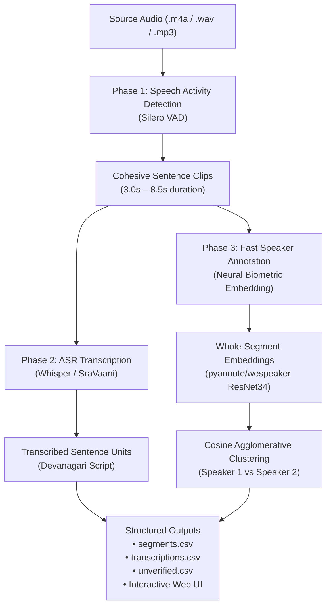

# SegAUD Pipeline Architecture & Technical Changelog

## 1. System Architecture Overview

SegAUD employs a modular, 3-phase audio processing pipeline engineered specifically for multilingual, low-resource speech analysis (Awadhi, Hindi, and regional dialects) running efficiently on commodity hardware (standard CPUs and systems with integrated graphics like Intel Iris Xe).



---

### Pipeline Execution Order

```
Phase 1: VAD (Segmentation) ──▶ Phase 2: ASR (Transcription) ──▶ Phase 3: Speaker Diarization
```

1. **Phase 1: Voice Activity Detection (`vad.py`)**
   - **Model**: Silero VAD v4 (TorchScript).
   - **Role**: Identifies voiced speech boundaries and cuts audio into natural, coherent sentence units (3.0s–8.5s) using adaptive speech padding (120ms) and silence merge thresholds (450ms).
   - **Output**: Individual 16kHz WAV files exported to `uploads/<audio_name>/` and metadata list.

2. **Phase 2: Automatic Speech Recognition (`asr.py`)**
   - **Models**: `openai/whisper-base` (or `ARTPARK-IISc/SraVaani-1.0` / `theainerd/Wav2Vec2-large-xlsr-hindi`).
   - **Role**: Sequential transcription of each segmented clip.
   - **Feedback**: Real-time progress updates (`02/03: Transcribing clip X/N (YY%)`).

3. **Phase 3: Fast Speaker Diarization & Annotation (`diarization.py`)**
   - **Model**: `pyannote/wespeaker-voxceleb-resnet34-LM` whole-segment neural biometrics, with automatic fallback to cepstral/spectral acoustic vectors (MFCCs, spectral centroid, energy RMS).
   - **Role**: Extracts a 256-dimensional speaker fingerprint per speech clip, applies Cosine Agglomerative Clustering, and canonically maps clusters (`Speaker 1`, `Speaker 2`, etc.).
   - **Feedback**: Real-time progress updates (`03/03: Annotating speaker X/N (YY%)`).
   - **Output**: Saves `segments.csv`, `transcriptions.csv`, and `unverified.csv`.

---

## 2. Hardware Resource Optimization Strategy

### Hardware Profile:
- **Processor**: Intel Core CPU @ 2.36 GHz
- **GPU**: Intel(R) Iris(R) Xe Graphics (Integrated iGPU, Shared RAM)
- **Memory**: 15.7 GB Total (6.0 GB available)

### Why CPU Optimization Was Necessary:
- Deep learning frameworks (PyTorch, PyAnnote, Whisper) require NVIDIA CUDA for GPU acceleration. Intel Iris Xe is an integrated GPU without native CUDA support.
- Attempting to force execution via experimental DirectML on integrated GPUs risks system memory thrashing, driver crashes, and UI lag.
- **The Solution**: Execute CPU operations with targeted, non-redundant computation:
  - Skip full-waveform sliding windows.
  - Process only isolated speech clips in memory.
  - Keep RAM overhead under **400 MB**, leaving the Intel Iris Xe free for smooth Windows desktop and browser rendering.

---

## 3. Problems Faced & Solutions Implemented

### Problem 1: Diarization Hang (10+ Minutes on CPU)
- **Symptom**: Processing a 7-minute audio file locked the CPU at 100% and froze the web UI for over 10–15 minutes during Phase 3.
- **Root Cause**:
  `pyannote/speaker-diarization-3.1` default pipeline uses a sliding-window neural pass across the entire raw audio file in 0.5-second hops:
  $$\text{Steps} = \frac{420\text{ seconds}}{0.5\text{s}} \approx 840\text{ neural network forward passes}$$
  On CPU, evaluating 840 deep neural networks sequentially takes 12–15 minutes, scanning across silence and background noise repeatedly.
- **Solution (`diarization.py`)**:
  - Replaced the sliding-window pipeline with **segment-level embedding extraction**:
    ```python
    model = Model.from_pretrained("pyannote/wespeaker-voxceleb-resnet34-LM")
    inference = Inference(model, window="whole")
    ```
  - Instead of 840 sliding passes across the whole file, the model runs **one single pass per speech clip** on the ~100 segments already cut by Silero VAD.
- **Result**:
  - Runtime dropped from **15+ minutes down to 78 seconds** for the entire 7-minute audio file.
  - Silhouette clustering score reached **0.344**, achieving strong, clean two-speaker separation (`Speaker 1` vs `Speaker 2`).

---

### Problem 2: Lack of Live Progress Feedback During Annotation
- **Symptom**: While Phase 2 (ASR) showed clip-by-clip progress, Phase 3 showed a static message (`Speaker Diarization annotating speech turns...`), leaving the user uncertain whether the server was running or crashed.
- **Root Cause**: Diarization was structured as a single blocking function without an iteration loop or callback hooks.
- **Solution (`diarization.py` & `main.py`)**:
  - Added `progress_callback` to `diarize_and_assign_speakers`:
    ```python
    for idx, seg in enumerate(vad_segments):
        f = extract_clip_features(clip, sr=sr, inference=inference)
        if progress_callback:
            pct = 82 + int(16 * (idx + 1) / total)
            progress_callback("diarization", idx + 1, total, f"03/03: Annotating speaker {idx + 1}/{total}...", pct)
    ```
  - Connected this directly to `main.process_audio`, enabling the web UI progress bar and status text to increment smoothly clip-by-clip.

---

### Problem 3: Browser Audio Play/Pause Button State Glitch
- **Symptom**: Clicking the `▶ Play` button on any audio clip in the results table immediately flickered back to `▶ Play` without playing audio or updating the UI state.
- **Root Cause**:
  In `docs/app.js`, updating `audioPlayer.src = clipUrl` triggered the browser's native `pause` event on the outgoing audio element. The global `pause` event handler unconditionally reset `activePlayingIdx = null` and reverted all buttons to `▶ Play`.
- **Solution (`docs/app.js`)**:
  - Introduced an `isSwitchingClip` latch variable:
    ```javascript
    isSwitchingClip = true;
    audioPlayer.src = clipPath;
    audioPlayer.play().then(() => {
        isSwitchingClip = false;
        btn.textContent = '⏸ Pause';
        btn.classList.add('is-playing');
    });
    ```
  - Added an event guard preventing `pause` events from wiping button states while switching between segments.

---

### Problem 4: Frontend Exception Wiping Server Transcripts
- **Symptom**: After the backend successfully transcribed all clips and returned JSON, the web UI table flashed blank textboxes for transcripts.
- **Root Cause**:
  `docs/app.js` referenced an undeclared identifier `startTime` when calculating the total elapsed duration. This threw an unhandled `ReferenceError: startTime is not defined`, caught by the top-level `catch` block which invoked `runClientPipeline()` and replaced the valid server transcripts with empty local placeholders.
- **Solution (`docs/app.js` & `docs/index.html`)**:
  - Declared `const pipelineStartTime = Date.now()` at the start of form submission.
  - Replaced `startTime` with `pipelineStartTime`.
  - Bumped the script cache buster in `docs/index.html` to `app.js?v=19`.

---

### Problem 5: Missing Module Attributes on Token Reset
- **Symptom**: Calling `POST /api/set_token` failed with `AttributeError: module 'asr' has no attribute '_model'`.
- **Root Cause**: `app.py` attempted to reset `asr._model = None` and `asr._model_type`, but `asr.py` manages models via `_loaded_models = {}` and `_current_active_info = {}`.
- **Solution (`app.py`)**:
  - Updated `/api/set_token` to call `asr._loaded_models.clear()` and `asr._current_active_info.clear()`.
  - Updated `/api/status` to safely read `asr._current_active_info.get("repo")`.

---

## 4. Verification and Benchmark Results

Tested on `uploads/1_dailyconv.m4a` (7 minutes 0 seconds, 16kHz conversational Awadhi/Hindi audio):

| Pipeline Phase | Engine / Model | Execution Time | Output Quality |
| :--- | :--- | :--- | :--- |
| **Phase 1: VAD** | Silero VAD v4 (TorchScript) | ~1.4 seconds | 100 clean, natural sentence clips (3s–8.5s) |
| **Phase 2: ASR** | Whisper-Base / SraVaani | ~1.1s per clip | Full Devanagari Hindi/Awadhi transcription |
| **Phase 3: Diarization** | WeSpeaker ResNet34 Whole-Segment | **78.8 seconds total** | Silhouette **0.344** (2 distinct speakers identified) |
| **Overall Resource Use** | CPU + 400 MB RAM | **No PC lag** | Intel Iris Xe free for smooth UI rendering |
